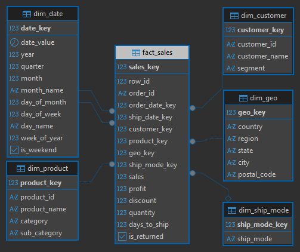
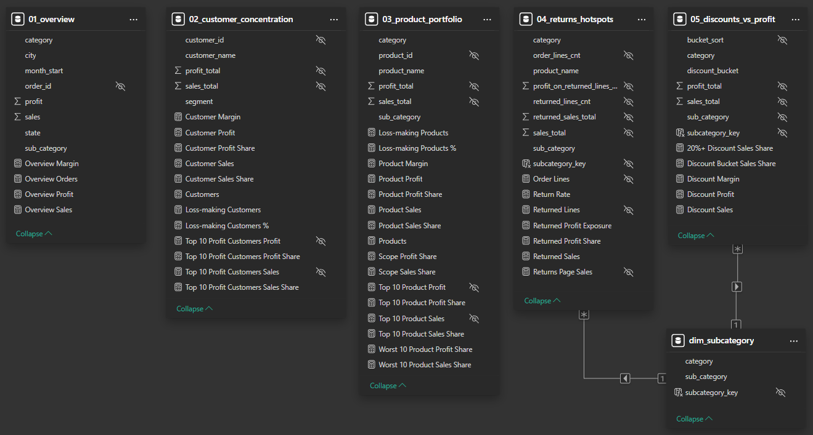
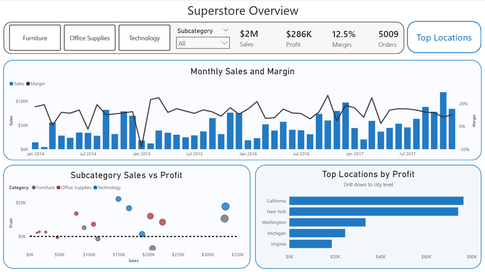
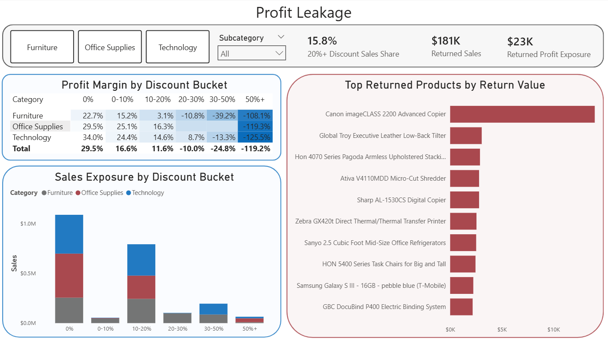
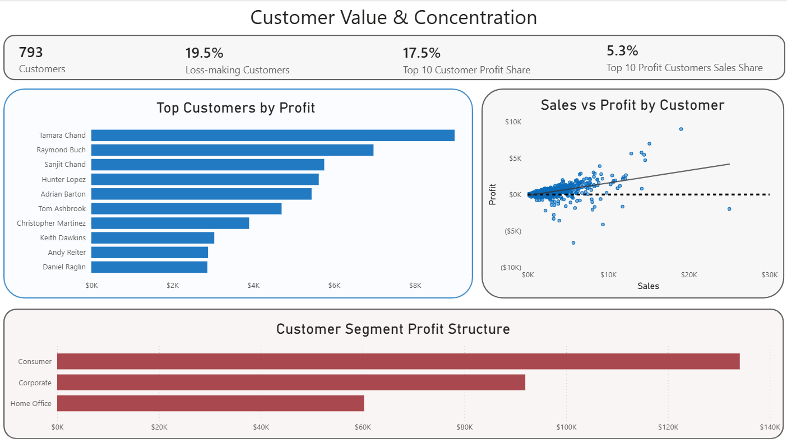
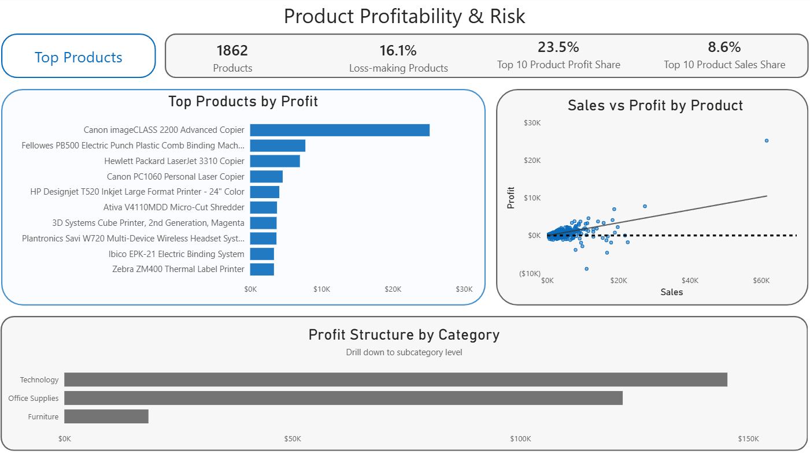

# Superstore Profitability Analysis — SQL + Power BI

## Project Overview

End-to-end analysis of retail sales, profit, and margin drivers based on the Superstore dataset.

- **Goal:** identify profit drivers, margin leakage, and performance across products, customers, and geographies
- **Stack:** SQL (PostgreSQL), Power BI
- **Pipeline:** CSV → RAW → STG → MART
- **Output:** interactive Power BI dashboard + reproducible SQL analysis layer

[**Interactive report (Power BI Service)**](https://app.powerbi.com/view?r=eyJrIjoiMjY4MWQxMzctYTE3Zi00YmY1LWI0MjItZGJlN2E2ZGQyYzZmIiwidCI6ImRmODY3OWNkLWE4MGUtNDVkOC05OWFjLWM4M2VkN2ZmOTVhMCJ9&pageName=b2a62fb3b49825f49e5e) | [**SQL**](./sql) | [**DAX Measures**](./dax/measures.md) | [**Data**](./data) 

**Data Source:** Publicly available Superstore dataset.

## Business Questions

This project focuses on a simple business problem: **sales alone do not explain performance**. A business can grow revenue while still weakening profitability through poor product mix, deep discounting, returns, or uneven performance across customers and geographies.

To break that problem into something measurable, the analysis was structured around four business areas:

- **Overall performance and business mix**
  - How are sales, profit, and margin changing over time?
  - Which categories, subcategories, and geographies already stand out as strong or weak contributors at a high level?

- **Profit leakage**
  - Where is margin being lost through discounting, returns, or structurally weak parts of the business?
  - Are these issues broad-based, or concentrated in specific products and segments?

- **Customer value and concentration**
  - Is profit distributed broadly across the customer base, or driven by a relatively small group of accounts?
  - How many customers are loss-making, and what does that say about customer quality?

- **Product portfolio performance**
  - Which products and subcategories create disproportionate value, and which ones dilute results despite generating sales?
  - How concentrated is portfolio profit in the top products, and how much downside comes from the weakest items?

## Data & Model

### Dataset

This project uses the **Superstore** retail dataset with order-level transactional data, including sales, profit, discounts, returns, products, customers, shipping details, and geographic attributes.

### Pipeline

The data pipeline follows a simple warehouse structure:

- **RAW**
  - source CSV files are loaded into raw landing tables without business transformations
  - all columns are stored as **TEXT** to preserve source values 1:1 and keep the landing layer fully traceable

- **STG**
  - raw fields are cleaned, trimmed, and standardized
  - dates are parsed into proper `DATE` columns
  - numeric measures such as `sales`, `profit`, `discount`, and `quantity` are cast into analytical types
  - blank values are normalized to `NULL` to make downstream joins and checks more reliable

- **MART**
  - the analytical layer is modeled as a **star schema**
  - transactional sales data is loaded into a central fact table and linked to dimensions for date, customer, product, geography, and ship mode
  - business-ready fields such as `days_to_ship` and `is_returned` are derived before the data reaches Power BI
  - reporting views are built on top of the mart layer to support dashboard pages directly

### Star Schema

The data model is implemented as a **star schema**:

- **`fact_sales`**
  - grain: **1 row = 1 order line**
  - measures: `sales`, `profit`, `quantity`, `discount`, `is_returned`
  - derived operational field: `days_to_ship`

- **dimensions**
  - `dim_date`
  - `dim_customer`
  - `dim_product`
  - `dim_geo`
  - `dim_ship_mode`

This structure separates transactional data from descriptive attributes and supports efficient aggregation, drill-down analysis, and cleaner BI modeling.

### Engineering Model

*SQL engineering model for the mart layer, showing the star schema used as the foundation for the analytical views.*

### Validation

To make the model reliable before building the dashboard, I added sanity checks across the pipeline:

- **RAW checks**
  - row counts after load
  - missing key fields such as `row_id`, `order_id`, `customer_id`, and `product_id`
  - duplicate `row_id` detection
  - order line distribution by `order_id`
  - date range checks for `order_date` and `ship_date`
  - numeric range checks for `sales`, `discount`, and `profit`
  - validation that return records match orders in the source data

- **STG checks**
  - row count parity between RAW and STG
  - return record match rate after transformation
  - min/max date validation after parsing
  - parse-failure checks for dates and numeric fields such as `sales`, `profit`, `discount`, and `quantity`

- **MART checks**
  - row count parity between `stg.orders` and `mart.fact_sales`
  - sales and profit parity between staging and fact data
  - null foreign key checks in the fact table
  - orphan key checks against all dimensions
  - return-order parity between source returns and fact rows marked as returned
  - shipping logic checks for `days_to_ship`, including null and negative values
  - product consistency checks for `product_id` values linked to multiple `product_name` values

### Performance / Modeling Notes

To support downstream reporting, I also added indexes on staging join fields and mart foreign keys. This keeps the SQL layer easier to query and makes Power BI work off a cleaner, lighter analytical model instead of rebuilding heavy business logic inside the report.

## SQL Views and DAX Used in the Dashboard

- **Page 1. Superstore Overview** — `vw_01_overview`
- **Page 2. Profit Leakage** — `vw_04_returns_hotspots`, `vw_05_discounts_vs_profit`
- **Page 3. Customer Value & Concentration** — `vw_02_customer_concentration`
- **Page 4. Product Profitability & Risk** — `vw_03_product_portfolio`

DAX is used for interactive KPIs, shares, rankings, and filter-aware report behavior.

### Reporting Model

*Power BI reporting model built on SQL analysis views, with a shared subcategory dimension used for cross-view filtering.*

## The Analysis

### Page 1. Superstore Overview

*This page sets the baseline for the whole report. It shows how the business grows over time, then adds just enough breakdown by category, subcategory, and geography to separate scale from quality.*

- Across the full period, Superstore generated about **$2.3M in sales**, **$286K in profit**, and a **12.5% margin** from **5,009 orders**.
- Sales trend upward over time, especially in the later part of the period, but margin stays visibly volatile from month to month. Growth is real, but business quality is less stable than revenue alone suggests.
- Category totals already show that sales and profit are not the same story. **Technology** generated about **$836.2K in sales** and **$145.5K in profit**, while **Office Supplies** delivered **$719K in sales** and **$122.5K in profit**. **Furniture** remained large at **$742K in sales**, but produced only **$18.5K in profit**.
- The subcategory view makes that gap more concrete. **Copiers** stand out as one of the clearest winners, with about **$149.5K in sales**, **$55.6K in profit**, and a **37.2% margin**. By contrast, **Tables** generated about **$207K in sales** but lost **$17.7K**, showing that volume alone is not a good quality check.
- Geography is uneven as well. **California** is the largest profit pool with about **$457.7K in sales** and **$76.4K in profit**, while **New York** contributes **$310.9K in sales** and **$74K in profit**. On the downside, **Texas** is the sharpest example of revenue without quality, with about **$170.2K in sales** but a **-$25.7K** profit result.

This page sets the business context for the rest of the report. Superstore is growing, but the early breakdown already shows that scale alone does not explain performance. The final result depends on what is sold, where it is sold, and how efficiently revenue turns into profit.

### Page 2. Profit Leakage

*This page moves from headline performance to what weakens it. It focuses on two practical sources of leakage: discounting and returns.*

- The discount analysis suggests that leakage is concentrated in the deeper discount buckets. Most sales still sit in the lower discount ranges, while **20%+ discounts account for only 15.8% of sales**. That is a relatively small revenue slice, but it is where profitability starts to break down.
- The sales exposure view also shows what healthier pricing looks like. For example, **Technology at 0% discount** delivers about **$389.7K in sales** with a **34.0% margin**, which gives a useful benchmark for cleaner revenue.
- Returns matter, but they look more concentrated than broad-based. The page tracks about **$180.5K in returned sales** and **$23.2K in returned profit exposure**.
- The ranking of returned products shows that a small number of products drive a large share of that problem. **Canon imageCLASS 2200 Advanced Copier** alone accounts for about **$14K in returned sales** and **28.9% of returned profit exposure** on the page.

This page shows that profit leakage is not random. Discounting is the broader structural pressure, while returns reveal a more concentrated set of product-level problem areas. Together, these patterns explain why solid sales performance does not always translate into equally strong profit.

### Page 3. Customer Value & Concentration

*This page asks whether profit is broadly distributed across the customer base or carried by a narrow group of accounts.*

- The customer base is broad, with **793 customers**, and it is not fully winner-takes-all. The **top 10 customers by profit** generate **17.5% of total profit** while accounting for **5.3% of sales**, which confirms that the strongest accounts contribute disproportionately more profit than revenue.
- Customer quality varies a lot. **155 customers, or 19.5% of the customer base, are loss-making**, which means weak accounts are part of the portfolio, not just a few isolated outliers.
- The scatter plot reinforces that point. Higher sales usually help, but they do not guarantee good profit. Some customers with meaningful revenue still sit close to, or below, the zero-profit line.
- The top-customer ranking shows what strong accounts look like in practice. **Tamara Chand** leads the list with about **$19.1K in sales** and **$9K in profit**, while **Tom Ashbrook** combines **$14.6K in sales** with a **32.2% margin**.
- Segment mix is fairly balanced, but **Consumer** is the largest profit contributor. It brings in about **$1.16M in sales** and **$134.1K in profit**, which equals **46.8% of total profit**. **Corporate** and **Home Office** remain meaningful contributors rather than rounding errors.

This page shifts the focus from overall performance to customer quality. Revenue is spread across a broad customer base, but profit is much more selective. That makes customer mix an important part of the story, not just a supporting detail.

### Page 4. Product Profitability & Risk

*This is the most detailed page in the report. It shows where portfolio quality is created, where it leaks, and how much that depends on a relatively small set of products and subcategories.*

- Concentration exists, but the portfolio is not carried by only one or two items. The **top 10 products** generate **23.5% of total profit** from **8.6% of sales**, so the strongest products clearly punch above their weight.
- The downside is meaningful as well. The **worst 10 products** represent **5.3% of sales** but drag down total profit by **10.3%**, which shows how a small group of SKUs can materially dilute the result.
- Loss-making products are not rare. About **16.1% of products** sit below zero profit.
- The ranking views make the contrast very clear. **Canon imageCLASS 2200 Advanced Copier** is the standout winner, with about **$61.6K in sales**, **$25.2K in profit**, a **40.9% margin**, and **8.8% of total profit**. At the other end, **Cubify CubeX 3D Printer Double Head Print** posts about **$11.1K in sales** and **-$8.9K in profit**, with an **-80% margin**.
- The product scatter keeps the same message visible across the full portfolio. Sales and profit are positively related overall, but the spread around that trend is wide, so scale alone still does not protect profitability.
- Category structure explains part of that spread. **Technology** contributes **36.4% of sales** but **50.8% of profit**, while **Furniture** contributes **32.3% of sales** and only **6.4% of profit**.
- Drill-down adds the real portfolio story. **Copiers** are a strong profit engine with about **$149.5K in sales** and **$55.6K in profit**. **Tables** do the opposite, generating about **$207.0K in sales** but losing **$17.7K**. **Machines** are another useful warning sign, with meaningful revenue but only about **$3.4K in profit**.

This page brings the analysis down to the SKU level, where portfolio concentration becomes much easier to see. It shows which products and subcategories create outsized value, which ones weaken the result despite generating sales, and where the product mix deserves the closest attention.

## Strategic Recommendations

- **Reduce exposure to deep discounting**
  - The strongest warning sign on the dashboard is the sharp margin deterioration in the deeper discount buckets. While **20%+ discounts account for only 15.8% of sales**, total margin already turns negative at **20–30% (-10.0%)**, worsens at **30–50% (-24.8%)**, and collapses at **50%+ (-119.2%)**. A practical next step would be to tighten discount caps, especially in already weak areas, and require stronger justification for discounts above 20%.

- **Prioritize margin repair in Furniture, especially Tables**
  - **Furniture** generates about **$742K in sales** but only **$18.5K in profit**, making it the weakest major category by margin quality. Within it, **Tables** are the clearest issue: about **$207K in sales** but **-$17.7K in profit**. That makes Tables a strong candidate for immediate review of pricing, discount depth, shipping cost structure, and product mix before pushing for more volume.

- **Protect high-profit products from unnecessary discount pressure**
  - The portfolio already contains clear profit engines. **Copiers** generate about **$149.5K in sales**, **$55.6K in profit**, and a **37.2% margin**, while **Canon imageCLASS 2200 Advanced Copier** alone contributes **8.8% of total profit**. These products should be treated differently from weak performers: lower discount pressure, tighter availability control, and closer analysis of what drives their unusually strong profit conversion.

- **Investigate return-heavy products individually, not just at category level**
  - Returns are meaningful at page level, with about **$180.5K in returned sales** and **$23.2K in returned profit exposure**, but the issue is concentrated rather than evenly spread. **Canon imageCLASS 2200 Advanced Copier** alone accounts for about **$14K in returned sales** and **28.9% of returned profit exposure** on the page. This suggests a product-level review is needed to separate demand quality issues from fulfillment, packaging, or product-specific causes.

- **Manage customers by profitability, not just revenue**
  - The customer base is broad, but profit is much more concentrated than sales. The **top 10 customers by profit** generate **17.5% of total profit** while accounting for only **5.3% of sales**, and **19.5% of customers are loss-making**. This supports a more selective customer strategy: review the least profitable accounts for discount intensity, basket mix, and servicing cost rather than treating all revenue as equally valuable.

- **Use geographic underperformance as a diagnostic signal**
  - Some geographies combine meaningful scale with weak economics. **Texas** generates about **$170.2K in sales** but loses **$25.7K**, while **Ohio** and **Pennsylvania** also post negative profit. These states should not be treated as simple growth opportunities. They are better seen as diagnostic markets where pricing, discounting, and product mix need to be reviewed before trying to grow volume further.

- **Concentrate on the small set of SKUs that drive both upside and downside**
  - Product concentration is strong enough to support targeted action. The **top 10 products** generate **23.5% of total profit** from **8.6% of sales**, while the **worst 10 products** account for **5.3% of sales** but drag down performance materially. That makes a SKU-level action list realistic: protect the winners, review the loss-makers, and avoid spreading attention evenly across the whole portfolio.

## Technical Highlights

### SQL / PostgreSQL

- built a layered warehouse pipeline: **RAW → STG → MART**
- cleaned, standardized, and typed source data in staging
- modeled the analytical layer as a **star schema**
- created reusable SQL views to support the main dashboard analyses
- added validation checks across layers, including row-count parity, parsing checks, join integrity, and fact-to-source reconciliation

### Data Modeling

- defined the transactional grain as **1 row = 1 order line**
- separated transactional data from descriptive attributes through dimensions
- derived fields such as **`is_returned`** and **`days_to_ship`** before data reached Power BI
- kept the model simple, auditable, and aligned with reporting needs

### Power BI

- connected Power BI to SQL-based analytical views rather than raw transactional tables
- implemented drill-down paths such as **category → subcategory** and **state → city**
- used DAX for interactive logic, including **share-of-total measures**, **Top / Worst rankings**, and **filter-aware KPIs**
- focused on clarity, drillability, and decision support rather than visual density

## Out of Scope / Further Questions

This dashboard focuses on profitability, leakage, customer concentration, and product mix. Natural extensions of the project could include customer growth over time, category-level seasonality, shipping impact, product-level return-rate analysis, and a deeper look at discount patterns over time.

## Closing Thoughts

This project combines SQL modeling and Power BI reporting into one practical profitability analysis workflow. The result is an interactive dashboard backed by a structured analytical layer for exploring performance across products, customers, and geographies.